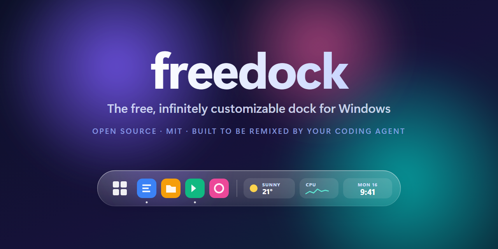
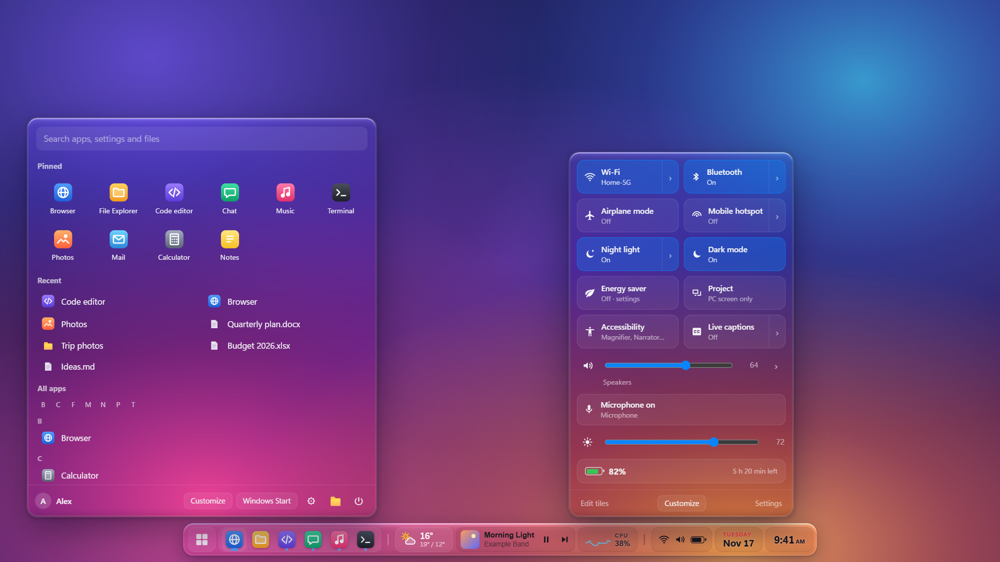
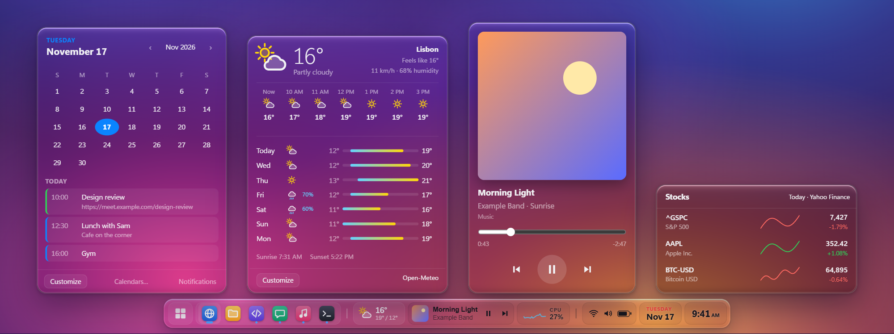

<p align="center"></p>

<p align="center">
  <a href="https://github.com/shawnzhu02/freedock/releases/latest"><b>Download</b></a> ·
  <a href="docs/WIDGETS.md">Widgets</a> ·
  <a href="docs/CUSTOMIZING.md">Make it yours</a> ·
  <a href="AGENTS.md">For coding agents</a>
</p>

**freedock** replaces the Windows taskbar with a glass dock full of live widgets: your apps, a Start
menu, the clock and calendar, weather, system stats, media, to-dos, AI usage and more. It's free, it's
MIT-licensed, and it's built so you (or your coding agent) can change anything about it.

<p align="center"></p>

## Why

I wanted a dock like this, and the ones I found cost money. Software this simple to make shouldn't. I
built freedock in a day with a coding agent, so I'm giving it away: use it as it is, or treat it as a
template. Clone it, tell your agent what you want ("a widget with my Steam friends", "a neon theme",
"a Pomodoro mood"), and it's yours.

## What it does

- **A real taskbar replacement.** Pinned and open apps grouped by program, live window previews on
  hover, a right-click menu (switch window, new window, pin, close), drag to reorder pins, drop a file
  on an app to open it with that app, Win+1-9, the tray, Show desktop, Task View, Search, keyboard
  language. Windows' taskbar comes back exactly as it was when freedock quits.
- **Its own Start menu, searching like Windows' Start.** It uses the same Windows Search index, the
  same Settings search index and the same launch history as Windows' Start, so it finds the same apps
  (portable programs too), settings, folders and documents, grouped the same way (Best match, Apps,
  Settings, Folders, Documents...). Ctrl+Shift+Enter runs as administrator; right-click opens the file
  location. Plus a pinned grid, recent apps, all apps A-Z and power options. Optionally opens on the
  Windows key; Windows' own Start is one click away.
- **61 widgets.** Clock, date, world clocks, weather and air quality, calendar with Join buttons, day
  timeline, to-dos, CPU, GPU, memory, network, media controls, Quick Settings (Wi-Fi, Bluetooth,
  volume, brightness, dark mode...), stocks, currency converter, news headlines, photo frame,
  shortcuts, clipboard history, notes, focus timer, screen time, GitHub,
  Docker, projects, Claude usage and sessions, Quick Ask, stickers, and more. [Full list](docs/WIDGETS.md).
- **Moods.** Saved layouts you switch between: Daily, Focus, Coding, or your own. Each has its own
  widgets and, if you like, its own look. One click, a scroll, or Ctrl+Alt+Shift+M.
- **Looks.** Glass that refracts your wallpaper (or the live screen), tinted, midnight, black, white
  or clear; a floating pill or a full-width bar; any edge of any monitor; size, roundness, accent.
- **Shows up when you want it.** Always, Smart (tucks away while a window is maximized) or Auto-hide,
  with how close and how long you set yourself.
- **Your calendar, your to-dos.** Paste a private iCal link from Google, Outlook or iCloud; keep a
  local to-do list; or connect your own [MCP server](docs/MCP_AGENDA.md).

<p align="center"></p>

## freedock and lumabar

freedock was inspired by [lumabar](https://lumabar.xyz), a polished paid dock. If you want more
widgets out of the box and support from its maker, buy it. If you want free and fully open, here's
freedock.

| | freedock | lumabar |
|---|---|---|
| Price | Free | $5.99 one-time |
| Source code | Open (MIT) | Not published |
| Widgets | 61 | 100+ |
| Change anything | Yes: edit the code, or ask a coding agent | Settings and options |
| Account or telemetry | None | None |

freedock is not affiliated with lumabar. Prices and features as listed on lumabar.xyz in November 2026.

## Install

1. Download the installer (`freedock_x.y.z_x64-setup.exe`), the `.msi`, or the portable `.zip` from
   [Releases](https://github.com/shawnzhu02/freedock/releases/latest).
2. The builds aren't code-signed yet, so Windows SmartScreen may warn you. Click **More info**, then
   **Run anyway**. (You can always build it yourself, below.)
3. freedock starts with your taskbar's desktop-app pins (Store apps you pin from the dock or Start). Right-click the dock or press Ctrl+Alt+D for
   Settings. Quit from the tray icon.

Needs Windows 10 or 11 (64-bit). WebView2 is built into both.

**If the taskbar ever stays hidden** (it shouldn't: a guard process restores it even if freedock is
killed), run `freedock.exe --restore-taskbar`.

## Make it yours with a coding agent

```sh
git clone https://github.com/shawnzhu02/freedock
cd freedock
npm install
npm run tauri dev
```

Open the folder in Claude Code, Codex, Cursor or Copilot and ask for what you want. The agent reads
[AGENTS.md](AGENTS.md), which maps the code and has recipes for widgets, flyouts, settings and themes.
`npm run new:widget -- "My widget"` scaffolds one. More ideas in [docs/CUSTOMIZING.md](docs/CUSTOMIZING.md).
Build your own installer with `npm run tauri build`.

You'll need [Node.js](https://nodejs.org) 20+, [Rust](https://rustup.rs) and Microsoft's
[C++ Build Tools](https://visualstudio.microsoft.com/visual-cpp-build-tools/) ("Desktop development
with C++"; the Rust installer offers to set them up). The first build takes a few minutes; later ones
are quick.

## Light on your PC

Tauri and Rust, not Electron. Pollers stop while the dock is tucked away, animations pause, hidden
windows release memory, and the settings window only exists while it's open.

Measured with `scripts/perf.ps1` on a laptop, idle, with the live-glass effect on: about **1% of one
CPU core**, and **~310 MB** of private memory across all its processes (most of it WebView2's GPU
process). With wallpaper glass (the default) it's lower.

## Privacy

Everything stays on your PC: settings, notes, to-dos, clipboard history (in memory only) and screen
time. There are no accounts and no telemetry. Widgets that go online talk straight to their own
service: Open-Meteo for weather (no key), your calendar links, GitHub through your own `gh` CLI, and
the sites you add to the status widget. Calendar links and MCP server links are encrypted for your
Windows user.

## What it can't do (yet)

- **Progress bars and unread badges on app icons.** Apps send those only to Windows' own taskbar.
- **A dock on every monitor at once.** Pick the monitor in Settings; on the others Windows' taskbar stays, set to auto-hide (Windows applies that setting to every display).

## Contributing

Pull requests are welcome: new widgets, themes, fixes. See [CONTRIBUTING.md](CONTRIBUTING.md).
Report security problems privately ([SECURITY.md](SECURITY.md)).

## License

[MIT](LICENSE) © 2026 shawnzhu02 and freedock contributors.
